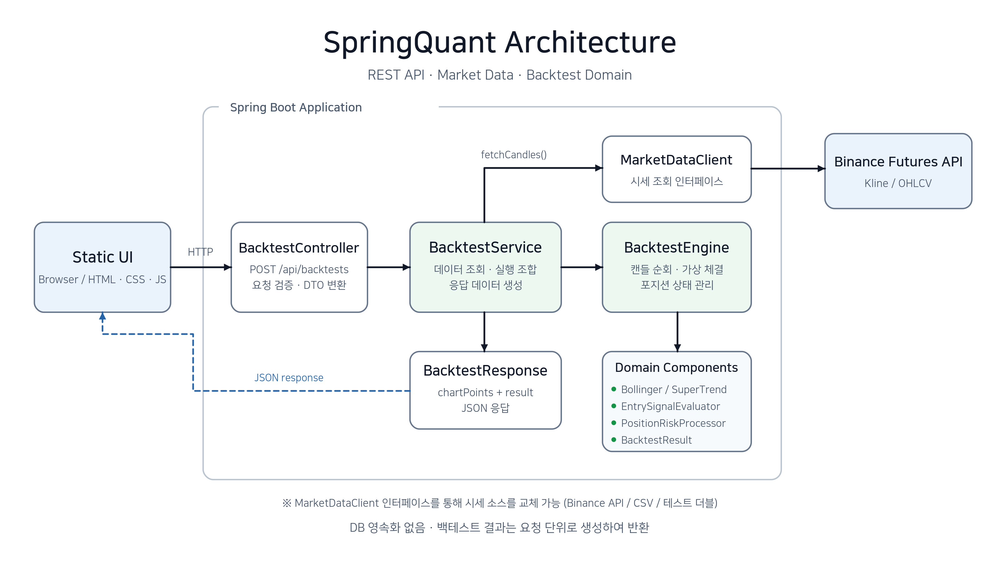
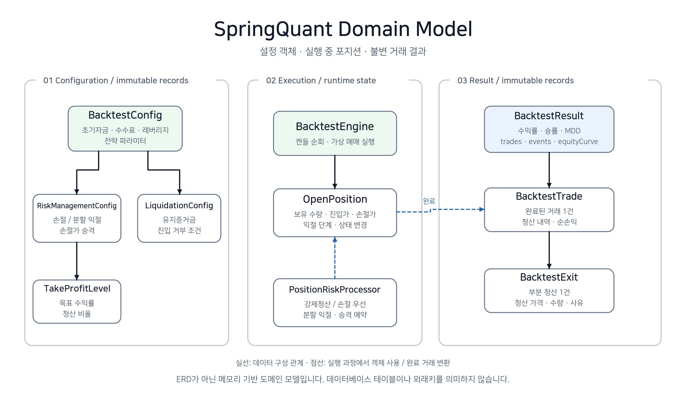
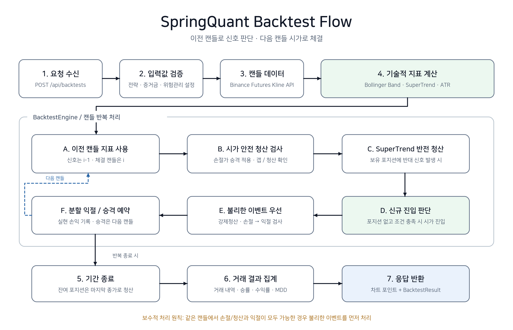

# SpringQuant

SpringQuant는 암호화폐 선물의 과거 캔들 데이터를 기반으로 매매 전략과 리스크 관리 규칙을 검증하는 Spring Boot 백테스트 애플리케이션입니다.

전략 조건, 수수료, 슬리피지, 레버리지 등을 입력하면 가상 거래를 실행하고, REST API와 웹 화면에서 거래 내역 및 성과 지표를 확인할 수 있습니다.

실제 주문을 전송하거나 자동 매매를 수행하지 않으며, 과거 데이터를 이용한 전략 검증에 집중합니다.

## 목차

- [주요 기능](#주요-기능)
- [기술 스택](#기술-스택)
- [아키텍처](#아키텍처)
- [프로젝트 구조](#프로젝트-구조)
- [도메인 모델](#도메인-모델)
- [백테스트 흐름](#백테스트-흐름)
- [현재 구현 범위](#현재-구현-범위)
- [실행 방법](#실행-방법)
- [API 사용 예시](#api-사용-예시)
- [테스트](#테스트)

## 주요 기능

| 기능 | 내용 |
| --- | --- |
| 시장 데이터 조회 | Binance Futures Kline API에서 캔들을 페이지 단위로 조회하고, 아직 완료되지 않은 캔들 제외 |
| 전략 실행 | Bollinger Band와 SuperTrend 계산, 추세 전환·중심선 반등·밴드 접근 기반 진입 조건 지원 |
| 가상 체결 | 이전 캔들로 신호를 판단하고 다음 캔들 시가에 수수료·슬리피지·레버리지를 반영하여 체결 |
| 리스크 관리 | 손절, 단계별 분할 익절, 유지증거금 기준 강제청산, 익절 이후 손절가 승격 |
| 결과 분석 | 수익률, 승률, 수수료, 최대 낙폭(MDD), 거래·청산 내역, 이벤트 및 자산 곡선 집계 |
| 결과 시각화 | 웹 화면에서 캔들·지표·매매 마커·자산 곡선과 거래 내역 확인 |

## 기술 스택

| 구분 | 사용 기술 |
| --- | --- |
| 언어 | Java 21 |
| 프레임워크 | Spring Boot 4.1.0 |
| 빌드 | Gradle Wrapper |
| API | Spring Web MVC, Jakarta Bean Validation |
| HTTP 클라이언트 | Spring RestClient |
| API 문서 | springdoc-openapi, Swagger UI |
| 테스트 | JUnit Jupiter, Spring Boot Test, Mockito, MockMvc, MockRestServiceServer |
| 화면 | HTML, CSS, JavaScript, lightweight-charts |

## 아키텍처

<p align="center">
  <a href="docs/images/springquant-architecture.png">
    
  </a>
</p>

SpringQuant는 REST API 계층과 백테스트 도메인 계산 로직을 분리한 Spring Boot 애플리케이션입니다.

- **BacktestController**: 백테스트 요청 수신, 입력값 검증 및 응답 처리
- **BacktestService**: 시장 데이터 조회, 백테스트 실행 및 차트 응답 데이터 생성
- **MarketDataClient**: 시장 데이터 조회 인터페이스로, Binance Futures API 등 데이터 소스 교체 가능
- **BacktestEngine**: 캔들 기반 전략 실행 및 가상 포지션 관리
- **PositionRiskProcessor**: 손절, 강제청산, 분할 익절 등 리스크 관리
- **BacktestResult**: 거래 내역, 수익률, 승률, MDD 및 자산 곡선 집계

현재 별도의 데이터베이스 없이 요청 단위로 백테스트를 수행하며, 계산 결과를 JSON 응답으로 반환합니다.

### 설계 선택

- **API 처리와 계산 로직 분리**: 엔진이 HTTP 요청·응답 모델에 의존하지 않도록 구성해, 캔들과 설정 객체만으로 도메인 로직을 테스트할 수 있게 했습니다.
- **시장 데이터 조회 추상화**: 서비스가 `MarketDataClient` 인터페이스에 의존하도록 구성해 데이터 소스 교체와 외부 API 호출을 대체한 테스트가 가능하게 했습니다.
- **입력 검증과 오류 응답 통일**: Bean Validation과 설정 객체의 생성자에서 입력값을 검증하고, 전역 예외 처리에서 오류 메시지와 필드별 검증 결과를 공통 형식으로 반환합니다.
- **상태 변경 범위 제한**: 설정과 결과는 Java `record`와 불변 리스트로 관리하고, 실행 중 변경되는 상태는 `OpenPosition`에 모았습니다.
- **리스크 규칙 분리**: 손절, 익절, 강제청산 및 손절가 승격처럼 분기와 상태 변화가 많은 로직을 역할별 클래스로 나눴습니다.

## 프로젝트 구조

```text
src/main/java/io/github/devssw/springquant
|-- backtest
|   |-- api        # 백테스트 REST API 요청/응답 모델
|   |-- engine     # 백테스트 실행, 포지션, 체결가, 청산가, 리스크 처리
|   |-- model      # 백테스트 설정, 진입 모드, 손절/익절 설정
|   |-- result     # 거래 결과, 이벤트, 자산 곡선, MDD 계산
|   `-- service    # 시장 데이터 조회와 엔진 실행 조합
|-- common
|   `-- api        # 공통 오류 응답과 예외 처리
|-- indicator
|   |-- bollingerband
|   `-- supertrend
|-- market
|   `-- candledata # Binance API 클라이언트, CSV 캔들 리더
`-- strategy       # 전략 결과와 신호 모델

src/main/resources/static
|-- index.html
|-- css/backtest.css
`-- js/backtest.js
```

---

## 도메인 모델

<p align="center">
  <a href="docs/images/springquant-domain-model.png">
    
  </a>
</p>

SpringQuant는 영속 데이터베이스를 사용하지 않으므로 ERD 대신 백테스트 실행에 필요한 주요 도메인 객체의 관계를 정리했습니다.

### 설정 객체 (Configuration)

- `BacktestConfig`: 초기 자산, 수수료, 레버리지 및 전략 파라미터
- `RiskManagementConfig`: 손절률, 분할 익절 및 손절가 승격 설정
- `TakeProfitLevel`: 익절 목표 수익률과 청산 비율
- `LiquidationConfig`: 유지증거금 및 강제청산 관련 설정

### 실행 객체 (Execution)

- `BacktestEngine`: 캔들 데이터를 순회하며 백테스트 실행
- `OpenPosition`: 실행 중인 포지션의 상태 관리
- `PositionRiskProcessor`: 손절, 강제청산 및 분할 익절 처리

### 결과 객체 (Result)

- `BacktestTrade`: 완료된 거래 한 건의 정보
- `BacktestExit`: 개별 청산 시점, 가격, 수량, 손익 및 사유
- `BacktestResult`: 전체 거래 결과 및 통계 집계

설정값은 Java `record` 기반 불변 객체로 관리하고, 실행 중 변경되는 포지션 상태는 `OpenPosition`에 한정했습니다. 완료된 거래와 최종 결과도 불변 객체로 반환합니다.

---

## 백테스트 흐름

<p align="center">
  <a href="docs/images/springquant-backtest-flow.png">
    
  </a>
</p>

백테스트는 과거 캔들 데이터를 시간순으로 순회하며 진입, 청산 및 리스크 관리 규칙을 적용합니다.

### 1. 데이터 조회 및 지표 계산

Binance Futures Kline API에서 OHLC 캔들 데이터를 조회하고, Bollinger Band와 SuperTrend를 계산합니다.

### 2. 신호 판단과 체결 시점 분리

완료된 이전 캔들(`i-1`)의 지표로 매매 신호를 판단하고, 다음 캔들(`i`)의 시가를 기준으로 체결합니다.

이를 통해 미래 데이터를 미리 참조하는 **Look-ahead Bias**를 방지합니다.

### 3. 포지션 진입 및 리스크 관리

진입 조건을 충족하면 레버리지, 증거금 사용 비율, 수수료 및 슬리피지를 반영해 가상 포지션을 생성합니다.

보유 포지션에는 다음 규칙을 적용합니다.

- 시가 갭 발생 시 안전 청산
- SuperTrend 추세 반전 청산
- 손절 및 유지증거금 기준 강제청산
- 단계별 분할 익절
- 익절 이후 손절가 승격 예약 및 다음 캔들 적용

동일 캔들에서 손절과 익절 조건이 모두 충족되는 경우 **강제청산 또는 손절과 같은 불리한 이벤트를 우선 처리**하여 백테스트 결과가 과대평가되지 않도록 했습니다.

### 4. 결과 집계 및 반환

백테스트 종료 시 포지션이 남아 있다면 마지막 캔들의 종가로 청산합니다.

이후 다음 정보를 집계해 차트 데이터와 함께 반환합니다.

- 최종 자산 및 총 수익률
- 총 거래 수 및 승률
- 총 손익, 수수료 및 순손익
- 최대 낙폭(MDD)
- 거래 내역 및 분할 청산 내역
- 이벤트 로그 및 시간별 자산 곡선

자산 곡선은 진입 수수료와 청산 시 실현 손익에 따른 잔고 변화를 기록합니다. MDD도 이 잔고 곡선을 기준으로 계산하며, 보유 중인 포지션의 미실현 손익은 포함하지 않습니다.

## 현재 구현 범위

이 프로젝트는 백테스트 검증에 집중하며 다음 기능은 현재 범위에 포함하지 않습니다.

- 실거래 주문 전송 및 거래소 API Key 기반 계정 연동
- 백테스트 결과의 데이터베이스 저장
- 로그인 및 회원 관리

결과 데이터는 요청 단위로 계산해 반환하며 별도의 영속 저장소에 저장하지 않습니다.

## 실행 방법

### 요구 사항

- JDK 21
- 인터넷 연결: 의존성 다운로드, Binance Futures API 조회 및 화면의 차트 라이브러리 로딩에 사용합니다.

### 애플리케이션 실행

프로젝트 루트에서 실행합니다.

```powershell
.\gradlew.bat bootRun
```

macOS / Linux에서는 다음 명령을 사용합니다.

```bash
./gradlew bootRun
```

실행 후 [백테스트 화면](http://localhost:8080)에 접속하여 종목, 기간, 전략 및 리스크 관리 설정을 입력합니다. 기본 포트는 `8080`이며, `SERVER_PORT` 환경 변수로 변경할 수 있습니다.

### Swagger UI

`backtest` 프로필로 실행하면 Swagger UI와 OpenAPI 문서가 활성화됩니다.

```powershell
.\gradlew.bat bootRun --args='--spring.profiles.active=backtest'
```

macOS / Linux에서는 `./gradlew bootRun --args='--spring.profiles.active=backtest'`를 사용합니다.

- [Swagger UI](http://localhost:8080/swagger-ui/index.html)
- [OpenAPI JSON](http://localhost:8080/v3/api-docs)

## API 사용 예시

### 백테스트 실행 요청

```http
POST /api/backtests
Content-Type: application/json
```

아래 JSON을 Swagger UI의 요청 본문에 입력해 실행할 수 있습니다. 예시의 시작 시각은 **2024-01-01 00:00 UTC**, 종료 시각은 **2024-02-01 00:00 UTC**입니다.

<details>
<summary>요청 본문 예시 펼치기</summary>

```json
{
  "symbol": "BTCUSDT",
  "interval": "1h",
  "startTimeMs": 1704067200000,
  "endTimeMs": 1706745600000,
  "initialBalance": 10000,
  "feeRate": 0.0004,
  "slippageRate": 0.0002,
  "leverage": 2,
  "marginUsageRate": 0.1,
  "bollingerPeriod": 20,
  "bollingerMultiplier": 2.0,
  "bollingerWidthMinPercent": 0,
  "superTrendLength": 10,
  "superTrendFactor": 3.0,
  "entryMode": "MA_BOUNCE",
  "maTolerancePercent": 0.15,
  "bbTolerancePercent": 0.15,
  "oneEntryPerTrend": true,
  "riskManagement": {
    "stopLossPercent": 2.0,
    "takeProfitLevels": [
      { "targetPercent": 1.0, "closeRatio": 0.5 },
      { "targetPercent": 2.0, "closeRatio": 0.3 },
      { "targetPercent": 3.0, "closeRatio": 0.2 }
    ],
    "stopPromotionMode": "BE_AFTER_TP1"
  },
  "liquidation": {
    "maintenanceMarginRate": 0.005,
    "maintenanceAmount": 0,
    "rejectEntryIfLiquidationBeforeStop": true,
    "stopBufferPercent": 0
  }
}
```

</details>

주요 입력값의 단위와 제약은 다음과 같습니다. 전체 요청 모델은 [BacktestRequest](src/main/java/io/github/devssw/springquant/backtest/api/BacktestRequest.java)와 Swagger UI에서 확인할 수 있습니다.

| 항목 | 단위 및 제약 |
| --- | --- |
| `startTimeMs`, `endTimeMs` | Unix 밀리초. 시작 시각은 0보다 크고 종료 시각은 시작 시각보다 커야 함 |
| `feeRate`, `slippageRate`, `maintenanceMarginRate` | 소수 비율. 예: `0.0004`는 `0.04%` |
| `marginUsageRate`, `closeRatio` | 소수 비율. 예: `0.1`은 `10%` |
| `stopLossPercent`, `targetPercent` 등 `Percent` 접미사 필드 | 퍼센트 단위. 예: `2.0`은 `2%` |
| `takeProfitLevels` | 목표 수익률은 오름차순, 청산 비율의 합은 `1.0` |
| `entryMode` | `ST_FLIP`, `MA_BOUNCE`, `BB_PIERCE` |
| `stopPromotionMode` | 예시의 `BE_AFTER_TP1`은 1차 익절 후 진입가로 손절가 승격을 예약. 전체 모드는 [StopPromotionMode](src/main/java/io/github/devssw/springquant/backtest/model/StopPromotionMode.java) 참고 |

### 응답

성공 시 `200 OK`와 함께 [BacktestResponse](src/main/java/io/github/devssw/springquant/backtest/api/BacktestResponse.java)를 반환합니다.

| 필드 | 내용 |
| --- | --- |
| `symbol`, `interval`, `startTimeMs`, `endTimeMs` | 요청한 종목, 캔들 간격 및 조회 시각 |
| `chartPoints` | 캔들 OHLC와 Bollinger Band·SuperTrend 지표. 지표 계산에 필요한 캔들이 부족한 초기 구간의 지표값은 `null` |
| `result` | 초기·최종 자산, 수익률, 거래 수, 승률, 손익, 수수료 및 MDD |
| `result.trades` | 완료된 거래와 거래별 분할 청산 내역 |
| `result.events` | 진입·청산·손절가 승격 등의 이벤트 |
| `result.equityCurve` | 수수료와 실현 손익을 반영한 시간별 잔고 |

요청값 검증 실패, 잘못된 JSON 또는 유효하지 않은 설정 조합은 `400 Bad Request`로 반환합니다. 공통 오류 응답인 [ApiErrorResponse](src/main/java/io/github/devssw/springquant/common/api/ApiErrorResponse.java)는 `timestamp`, `status`, `error`, `message`, `path`, `fieldErrors`를 포함합니다.

## 테스트

### 실행

```powershell
.\gradlew.bat test
```

macOS / Linux에서는 `./gradlew test`를 사용합니다. 실행 후 `build/reports/tests/test/index.html`에서 테스트 보고서를 확인할 수 있습니다.

### 주요 검증 항목

| 대상 | 검증 내용 | 테스트 코드 |
| --- | --- | --- |
| 백테스트 엔진 | 추세 전환 청산, 부분 익절 이후 잔여 수량 청산, 시가 갭 손절 우선 처리, 슬리피지 반영 | [BacktestEngineTest](src/test/java/io/github/devssw/springquant/backtest/engine/BacktestEngineTest.java) |
| 리스크 처리 | 같은 캔들에서 손절·강제청산과 익절에 모두 도달할 때 불리한 이벤트 우선 처리 | [PositionRiskProcessorTest](src/test/java/io/github/devssw/springquant/backtest/engine/PositionRiskProcessorTest.java) |
| 손절가 승격 | 익절 시 승격 예약, 다음 캔들에서 적용, 시가가 승격가를 침범하면 보류 | [StopPromotionProcessorTest](src/test/java/io/github/devssw/springquant/backtest/engine/StopPromotionProcessorTest.java) |
| 결과 계산 | 수수료·부분 청산을 반영한 자산 곡선, 동일 시각의 잔고 변화, 최대 낙폭 계산 | [EquityCurveCalculatorTest](src/test/java/io/github/devssw/springquant/backtest/result/EquityCurveCalculatorTest.java), [DrawdownCalculatorTest](src/test/java/io/github/devssw/springquant/backtest/result/DrawdownCalculatorTest.java) |
| 지표 계산 | Bollinger Band·SuperTrend 계산, 초기 계산 불가 구간과 잘못된 파라미터 처리 | [BollingerBandCalculatorTest](src/test/java/io/github/devssw/springquant/indicator/bollingerband/BollingerBandCalculatorTest.java), [SuperTrendCalculatorTest](src/test/java/io/github/devssw/springquant/indicator/supertrend/SuperTrendCalculatorTest.java) |
| 시장 데이터 | 외부 API 응답의 캔들 변환, 미완료 캔들 제외, 조회 조건 검증 | [BinanceFuturesMarketDataClientTest](src/test/java/io/github/devssw/springquant/market/candledata/BinanceFuturesMarketDataClientTest.java) |
| 서비스 | 시장 데이터 조회와 엔진 실행 조합, 빈 조회 결과와 누락된 설정 처리 | [BacktestServiceTest](src/test/java/io/github/devssw/springquant/backtest/service/BacktestServiceTest.java) |
| REST API | 정상 응답, 필수값 누락, 잘못된 JSON, 수수료율 범위 위반 및 공통 오류 응답 | [BacktestControllerTest](src/test/java/io/github/devssw/springquant/backtest/api/BacktestControllerTest.java) |

서비스 테스트는 Mockito로 의존 객체를 대체하고, API 테스트는 MockMvc로 요청·응답을 검증합니다. 시장 데이터 클라이언트 테스트는 MockRestServiceServer로 외부 HTTP 응답을 재현하므로 실제 Binance API 호출 없이 실행됩니다.
